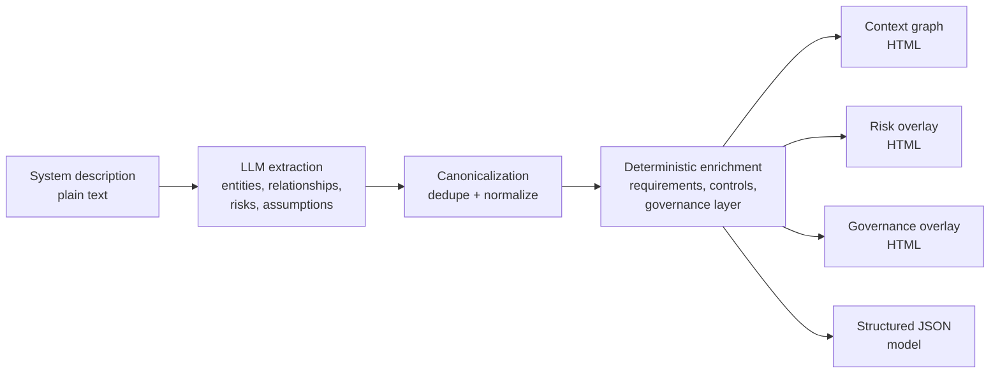

# LLM-Based System Context Analysis Assistant

An AI-assisted tool that turns a plain-English system description into an interactive **system-context model**: the actors, components, and external systems involved, how they relate, and what risks/assumptions are implied — extracted automatically by an LLM instead of drawn by hand.

## The problem

Early in designing any non-trivial system, you need a shared picture of its context: who's involved, what talks to what, where the system boundary is, what could go wrong. Normally someone draws this by hand from a requirements document, and it's stale by the next meeting. This project explores using an LLM to extract that context model directly from text — and keep it current as the description evolves.

## How it works



1. **Extraction** — the input text is sent to an LLM with a strict prompt, using schema-constrained structured output (not free-text JSON parsing) to guarantee a valid shape: entities (actors / internal components / external systems), relationships, risks, and assumptions, each with the supporting source sentence(s) attached. A referential-integrity check (every id referenced actually exists) catches what schema validation alone can't, with an automatic retry/repair pass on failure.
2. **Canonicalization** — extracted entities are deduplicated by normalized label + type (content-addressed IDs), so near-duplicate names don't create orphan nodes. Relationship labels (e.g. `streams_to`/`sends_signals_to`/`provides_alerts_to`) are normalized against a small canonical verb set, so the diagram doesn't accumulate inconsistent phrasing for the same kind of connection.
3. **Deterministic enrichment** — a rule-based layer fills in requirements (functional/non-functional), security & governance controls, and operational concerns, and links risks to the controls that mitigate them. This keeps the output complete and useful even when the LLM's raw extraction is sparse.
4. **Visualization** — three separate interactive graph views are rendered (via [pyvis](https://pyvis.readthedocs.io/)) instead of one overloaded diagram: a clean architecture/context view, a risk-traceability overlay, and a governance/requirements overlay.
5. **Caching** — outputs are cached by a hash of (input text + pipeline version), so repeated identical input doesn't re-trigger an LLM call.

## Tech stack

Python, a plain `http.server`-based backend (no web framework, by design), an OpenAI-compatible LLM API client, and `pyvis`/`vis-network` for the graph visualizations.

## Getting started

```bash
python -m venv .venv
source .venv/bin/activate   # .venv\Scripts\Activate.ps1 on Windows
pip install -r requirements.txt
```

Provide an OpenAI-compatible API key via the `UPB_AI_GATEWAY_KEY` environment variable, or a local `UPB_AI_GATEWAY_KEY.txt` file (gitignored — never commit this). The gateway URL/model are set in `llm_engine.py`; point them at whatever OpenAI-compatible endpoint you have access to.

```bash
python app_server.py
```

Open `http://127.0.0.1:8000`, paste or upload a system description (see `example_system_description.txt` for a sample input describing a hospital patient-monitoring system), and click **Analyze**.

## What's built

- Working end-to-end pipeline: extraction → graph → 3 interactive views + JSON export
- Deterministic entity de-duplication and canonicalization via content-hashed IDs, so near-duplicate labels don't create orphan nodes
- Automatic requirements, controls, and governance enrichment layered onto the extracted model
- 3 separate interactive graph views per run (context, risk, governance) plus 1 structured JSON export, instead of one overloaded diagram
- Input-hash-based caching — re-analyzing identical input costs zero additional LLM calls
- A per-session request cap as a built-in cost-control guardrail
- An evaluation harness (`run_evals.py`) with 5 hand-labeled test cases across varied domains (healthcare, e-commerce, IoT, fintech, logistics) — not just the one reference scenario — measuring entity/relationship extraction quality and risk/assumption coverage against ground truth
- Schema-constrained structured LLM output (Pydantic + strict JSON schema) with a referential-integrity check and an automatic retry/repair loop, replacing free-text JSON parsing
- Evidence traceability — every extracted entity/relationship/risk/assumption carries the source sentence(s) it came from, visible as hover tooltips in the diagrams, not just buried in the JSON export
- Relationship-label normalization against a canonical verb set, built from labels actually observed in practice rather than guessed

## Evaluation

Extraction quality is measured, not assumed, and changes are measured again after — not just assumed to have helped. `eval_cases.py` holds 5 hand-labeled system descriptions spanning different domains; `run_evals.py` runs the extraction pipeline against each and scores it with fuzzy entity matching (type + token-overlap), relationship-pair matching, and risk/assumption coverage.

Current baseline (macro-average across all 5 cases), after structured output + evidence traceability + relationship-label normalization:

| Metric | Score |
|---|---|
| Entity precision / recall / F1 | 0.97 / 0.77 / 0.86 |
| Relationship precision / recall / F1 | 0.81 / 0.85 / 0.83 |
| Risk coverage | 1.00 |
| Assumption coverage | 1.00 |
| Evidence grounded rate | 1.00 |
| Relationship label normalized rate | 0.67 |

Entity scores barely moved from the structured-output baseline — within normal run-to-run noise, not claimed as a real change. Relationship F1 moved more than that noise band (+0.045), but worth being precise about why: the relationship metric only grades whether the (source, target) entity pair was found, never the label text, so label normalization can't be the direct cause — and a dedup-side-effect hypothesis was checked against the actual data and didn't hold up either. The honest attribution is the combined prompt change (now also requesting evidence) plus ordinary variance, not the normalization specifically. What *is* cleanly attributable, since they're brand-new metrics: evidence grounding at 1.00 (every piece of captured evidence genuinely traces back to the source text) and label-normalization coverage at 0.67 (the fixed canonical-verb table, built from real observed labels, covers about two-thirds of what the model actually produces — the honest limitation of a fixed table vs. a costlier second LLM pass).

Run it yourself:

```bash
python run_evals.py
```

Full methodology and per-case findings are documented in the script's header comments and `eval_cases.py`.
