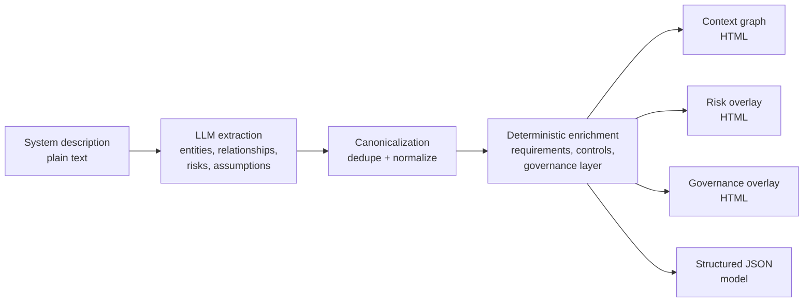

# LLM-Based System Context Analysis Assistant

An AI-assisted tool that turns a plain-English system description into an interactive **system-context model**: the actors, components, and external systems involved, how they relate, and what risks/assumptions are implied — extracted automatically by an LLM instead of drawn by hand.

## The problem

Early in designing any non-trivial system, you need a shared picture of its context: who's involved, what talks to what, where the system boundary is, what could go wrong. Normally someone draws this by hand from a requirements document, and it's stale by the next meeting. This project explores using an LLM to extract that context model directly from text — and keep it current as the description evolves.

## How it works



1. **Extraction** — the input text is sent to an LLM with a strict prompt requiring valid JSON output: entities (actors / internal components / external systems), relationships, risks, and assumptions.
2. **Canonicalization** — extracted entities are deduplicated by normalized label + type (content-addressed IDs), so near-duplicate names don't create orphan nodes.
3. **Deterministic enrichment** — a rule-based layer fills in requirements (functional/non-functional), security & governance controls, and operational concerns, and links risks to the controls that mitigate them. This keeps the output complete and useful even when the LLM's raw extraction is sparse.
4. **Visualization** — three separate interactive graph views are rendered (via [pyvis](https://pyvis.readthedocs.io/)) instead of one overloaded diagram: a clean architecture/context view, a risk-traceability overlay, and a governance/requirements overlay.
5. **Caching** — outputs are cached by a hash of (input text + pipeline version), so repeated identical input doesn't re-trigger an LLM call.

## Tech stack

Python, a plain `http.server`-based backend (no web framework, by design), an OpenAI-compatible LLM API client, and `pyvis`/`vis-network` for the graph visualizations.

## Getting started

```bash
python -m venv .venv
source .venv/bin/activate   # .venv\Scripts\Activate.ps1 on Windows
pip install -r requirements.txt
```

Provide an OpenAI-compatible API key via the `UPB_AI_GATEWAY_KEY` environment variable, or a local `UPB_AI_GATEWAY_KEY.txt` file (gitignored — never commit this). The gateway URL/model are set in `llm_engine.py`; point them at whatever OpenAI-compatible endpoint you have access to.

```bash
python app_server.py
```

Open `http://127.0.0.1:8000`, paste or upload a system description (see `example_system_description.txt` for a sample input describing a hospital patient-monitoring system), and click **Analyze**.

## What's built

- Working end-to-end pipeline: extraction → graph → 3 interactive views + JSON export
- Deterministic entity de-duplication and canonicalization via content-hashed IDs, so near-duplicate labels don't create orphan nodes
- Automatic requirements, controls, and governance enrichment layered onto the extracted model
- 3 separate interactive graph views per run (context, risk, governance) plus 1 structured JSON export, instead of one overloaded diagram
- Input-hash-based caching — re-analyzing identical input costs zero additional LLM calls
- A per-session request cap as a built-in cost-control guardrail
